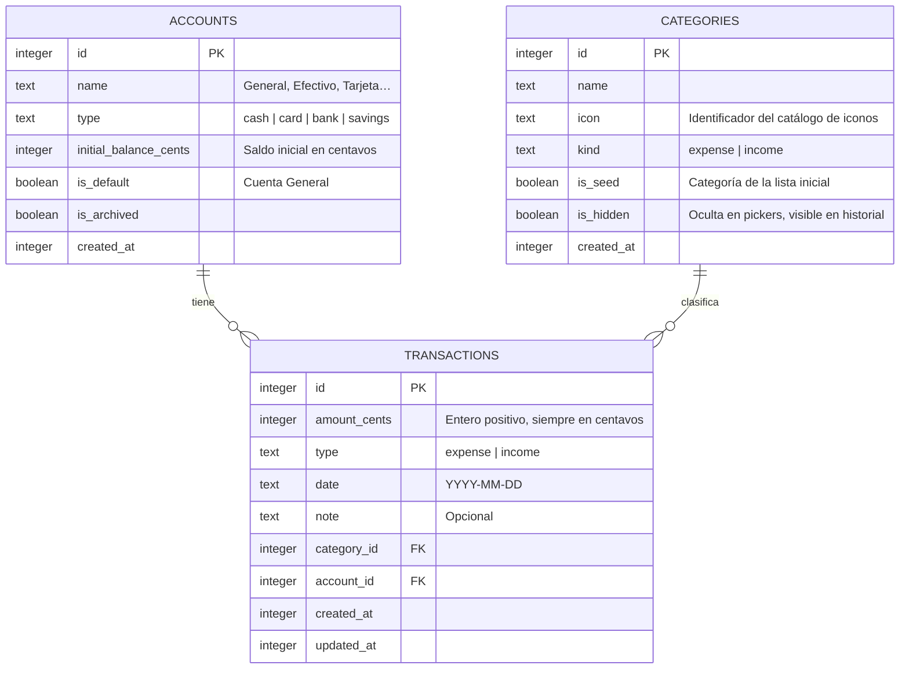

# 💸 Expense Tracker


> **App Android nativa para controlar tu dinero de forma rápida y privada.** Registra gastos e ingresos en segundos, fija presupuestos y descubre a dónde va tu dinero. Sin cuentas, sin nube, sin telemetría: **tus datos son tuyos.**

---

## 📑 Índice

- [Filosofía](#-filosofía)
- [Características](#-características)
- [Roadmap](#️-roadmap)
- [Estructura del proyecto](#-estructura-del-proyecto)
- [Modelo de datos](#-modelo-de-datos)
- [Stack técnico](#️-stack-técnico)
- [Requisitos previos](#-requisitos-previos)
- [Instalación y ejecución](#-instalación-y-ejecución)
- [Testing](#-testing)
- [Cómo contribuir](#-cómo-contribuir)
- [Distribución](#-distribución)
- [Decisiones de arquitectura](#️-decisiones-de-arquitectura-adrs)
- [Licencia](#-licencia)

## 🧭 Filosofía

Este proyecto se construye sobre cuatro principios no negociables:

1. **Local-first.** Todos tus datos financieros viven únicamente en tu dispositivo, en una base de datos SQLite. Ninguna funcionalidad esencial requiere internet, cuenta o servidor. La sincronización entre dispositivos (M4) será opcional y cifrada de extremo a extremo.
2. **Rapidez.** Apuntar un gasto debe costar menos de 5 segundos. Si registrar es incómodo, la app no se usa y el control del dinero se pierde.
3. **Privacidad por diseño.** Los datos de dinero son sensibles. La arquitectura por defecto no expone nada a terceros y el servidor de sync (cuando exista) nunca podrá leer tus datos en claro.
4. **Simple antes que completo.** Cada fase del roadmap entrega una app útil por sí misma. Ninguna fase nueva rompe lo anterior.

## ✨ Características

### M1 — Registro (MVP) · 🚧 en curso
- [ ] Registro rápido de gastos e ingresos: monto, fecha, categoría, nota y cuenta
- [ ] Categorías semilla en español, editables, con iconos
- [ ] Listado de transacciones agrupado por día
- [ ] Resumen mensual: ingresos, gastos y saldo por categoría
- [ ] Moneda configurable y dark mode

### M2 — Presupuestos · 📝 planeado
- [ ] Presupuesto mensual por categoría con barra de progreso
- [ ] Alertas al acercarte al límite (80% / 100%)
- [ ] Build de beta en APK para testers

### M3 — Análisis · 📝 planeado
- [ ] Gráficos: gasto por categoría y evolución mensual
- [ ] Filtros y búsqueda de transacciones
- [ ] Exportación CSV

### M4 — Sync y cuentas · 📝 planeado
- [ ] Registro opcional de usuario
- [ ] Sincronización cifrada de extremo a extremo entre dispositivos

### M5 — Extras · 📝 planeado
- [ ] Transacciones recurrentes, deudas y metas de ahorro
- [ ] Multi-moneda e importación de extractos bancarios CSV
- [ ] Backups completos y publicación en Google Play

## 🗺️ Roadmap

| Milestone | Nombre | Estado | Qué incluye |
|-----------|--------|--------|-------------|
| [M1](https://github.com/Juan-sjss/expense-tracker/milestone/1) | Registro (MVP) | 🚧 En curso | Transacciones, categorías, resumen mensual, moneda, tema |
| [M2](https://github.com/Juan-sjss/expense-tracker/milestone/2) | Presupuestos | 📝 Planeado | Presupuestos por categoría, alertas, APK beta |
| [M3](https://github.com/Juan-sjss/expense-tracker/milestone/3) | Análisis | 📝 Planeado | Gráficos, filtros, búsqueda, exportación CSV |
| [M4](https://github.com/Juan-sjss/expense-tracker/milestone/4) | Sync y cuentas | 📝 Planeado | Registro opcional + sync cifrado E2E |
| [M5](https://github.com/Juan-sjss/expense-tracker/milestone/5) | Extras | 📝 Planeado | Recurrentes, deudas, metas, multi-moneda, backups, Google Play |

Las fases M2–M5 están creadas como issues etiquetados `future` y se descomponen en issues más pequeños al iniciar cada fase.

## 🧱 Estructura del proyecto

```
expense-tracker/
├── .github/              # CI, plantillas de issue/PR, dependabot
│   ├── ISSUE_TEMPLATE/
│   ├── workflows/ci.yml
│   └── PULL_REQUEST_TEMPLATE.md
├── docs/adr/             # Decisiones de arquitectura (ADRs)
├── src/
│   ├── components/       # Componentes reutilizables (Button, CategoryPicker…)
│   ├── screens/          # Pantallas (Home, AddTransaction, Categories, Summary, Settings)
│   ├── navigation/       # Navegadores de react-navigation
│   ├── db/               # Esquema Drizzle, migraciones, seed y consultas tipadas
│   ├── stores/           # Estado global (zustand)
│   ├── theme/            # Tokens de tema claro/oscuro (NativeWind)
│   ├── utils/            # Lógica pura: dinero, fechas (100% testeada)
│   ├── hooks/            # Hooks custom
│   └── types/            # Tipos compartidos
└── __tests__/            # Tests
```

## 📊 Modelo de datos

Tres tablas SQLite en el corazón del MVP:



**Decisiones clave del modelo:**

- **Montos en centavos enteros** (`amount_cents`): la aritmética de dinero jamás usa floats. Ver [ADR-0003](docs/adr/0003-montos-en-centavos-enteros.md).
- **Moneda única por usuario**: se elige en configuración y solo afecta al formateo (`Intl.NumberFormat`), no al almacenamiento.
- **Cuentas desde el día 1**: la tabla `accounts` existe ya en el MVP, con la cuenta "General" por defecto, para evitar una migración dolorosa en fases futuras.
- **Categorías semilla editables**: la lista inicial (16 de gasto + 3 de ingreso) se siembra en el primer arranque; se pueden añadir, renombrar y ocultar, nunca borrar si tienen transacciones.

## 🛠️ Stack técnico

| Capa | Tecnología | Rol |
|------|-----------|-----|
| App | React Native (bare, sin Expo) | UI nativa Android |
| Lenguaje | TypeScript (`strict`) | Tipado end-to-end |
| Navegación | react-navigation | Navegación stack + tabs |
| Datos | SQLite + Drizzle ORM | BD local tipada con migraciones |
| Estado | zustand | Estado global ligero |
| Estilos | NativeWind (Tailwind) | Theming y dark mode |
| Ajustes | MMKV | Persistencia clave-valor rápida |
| Tests | Jest + React Native Testing Library | Unitarios y de componentes |
| CI | GitHub Actions | lint + typecheck + tests en cada PR |

## 📋 Requisitos previos

- **Node.js 20 LTS**
- **JDK 17**
- **Android Studio** con Android SDK y emulador (o dispositivo físico con depuración USB)
- Variable de entorno `ANDROID_HOME` configurada

## 🚀 Instalación y ejecución

> ⚠️ **Estado actual**: el repositorio arranca con documentación, plantillas y estructura. El scaffolding de la app se implementa en el [issue #1](https://github.com/Juan-sjss/expense-tracker/issues/1). Una vez completado:

```bash
# Clonar
git clone https://github.com/Juan-sjss/expense-tracker.git
cd expense-tracker

# Instalar dependencias
npm install

# Compilar y desplegar en emulador o dispositivo Android
npm run android

# Calidad
npm run lint        # ESLint
npm run typecheck   # tsc --noEmit
npm test            # Jest
```

## 🧪 Testing

- La **lógica de dinero y fechas** (`src/utils/`) es el corazón de la app y exige cobertura ≥ 90%.
- Cada pantalla incluye al menos un test de render con React Native Testing Library.
- **CI bloquea todo PR** que falle en lint, typecheck o tests.
- El workflow de CI está inerte hasta que existe `package.json` (issue #1) para no ensuciar el historial de un repo solo-documentación.

## 🤝 Cómo contribuir

Ver [CONTRIBUTING.md](CONTRIBUTING.md) para el flujo completo: ramas, commits convencionales, checklist de PR y reglas de tests.

Si es tu primera vez en el repo, busca los issues con la etiqueta `good first issue`. Los issues de fases futuras están etiquetados `future` y no deben picarse hasta iniciar su milestone.

## 📱 Distribución

- **Beta**: APK firmado distribuido directamente a testers (M2).
- **Estable**: publicación en Google Play (M5).
- **Android únicamente**: no hay planes de iOS. Ver [ADR-0002](docs/adr/0002-android-unicamente.md).

## 🏛️ Decisiones de arquitectura (ADRs)

| ADR | Decisión |
|-----|----------|
| [0001](docs/adr/0001-arquitectura-local-first.md) | Arquitectura local-first: sin servidor en el MVP, sync cifrado opcional en M4 |
| [0002](docs/adr/0002-android-unicamente.md) | Android únicamente, sin planes de iOS |
| [0003](docs/adr/0003-montos-en-centavos-enteros.md) | Montos como enteros en centavos, nunca floats |

## 📄 Licencia

[MIT](LICENSE) — Copyright (c) 2026 Juan
